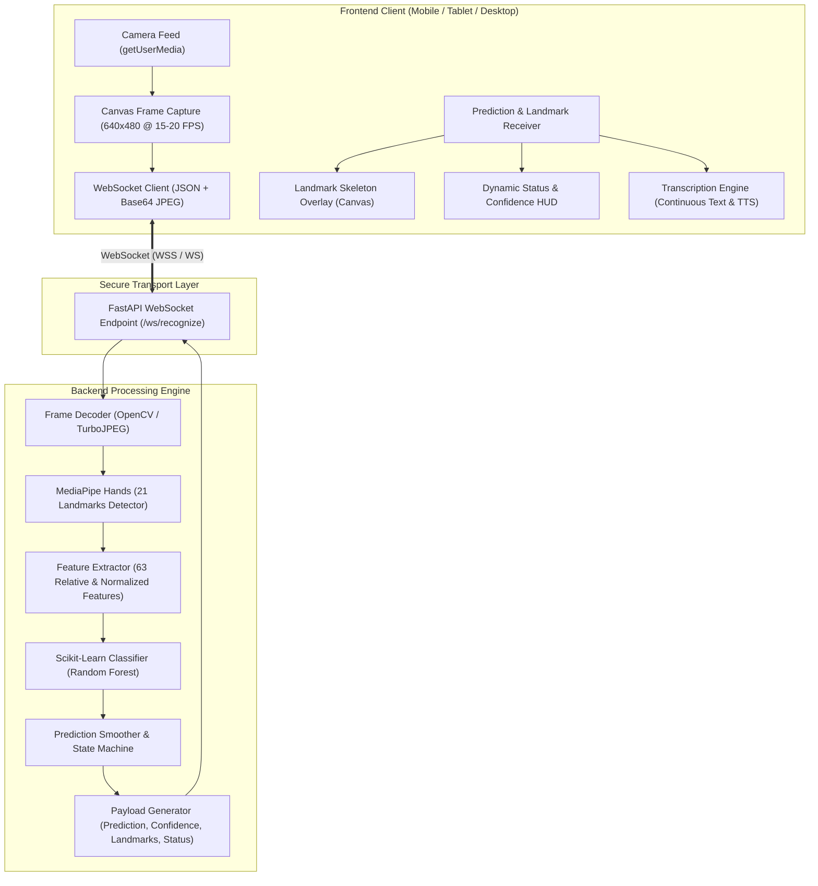

# BHAVIK System Architecture Specification

## 1. Executive Overview

**BHAVIK** (*Bridging Hands and Visual Intelligence through Knowledge*) is an end-to-end, real-time computer vision and machine learning system engineered for American Sign Language (ASL) alphabet fingerspelling recognition and continuous transcription.

The system is architected as a **mobile-first, cross-platform client-server web application**:
- **Client Tier**: Highly responsive progressive web application (HTML5, modern CSS3 with CSS Grid/Flexbox, ES6+ JavaScript), leveraging `navigator.mediaDevices.getUserMedia` for low-latency video streaming, Canvas API for landmark rendering, and WebSockets for full-duplex communication.
- **Server Tier**: High-throughput FastAPI application running on Uvicorn, integrating an OpenCV video ingestion engine, Google MediaPipe hand landmark extraction pipeline (21 3D keypoints), invariant feature transformation, a Scikit-Learn Random Forest Classifier, and an adaptive temporal prediction stabilizer.



---

## 2. Component Architecture

### 2.1 Video Capture & Client Frame Ingestion
- **Resolution**: Dynamically constrained to 640x480 (mobile) and up to 1280x720 (desktop), maintaining a 4:3 or 16:9 aspect ratio without non-linear stretching.
- **Frame Rate Regulation**: Client-side throttler limits frame transmission to 15–20 FPS to prevent mobile battery drain and thermal throttling while preserving real-time responsiveness.
- **Facing Mode**: Supports both `user` (front camera with automatic CSS preview mirroring) and `environment` (rear camera for signing by a peer).
- **Encoding**: Frames are rendered to an offscreen HTML5 Canvas and compressed to JPEG with an adaptive quality level (0.65–0.75), yielding payload sizes under 25–40 KB per frame.

### 2.2 Computer Vision Engine (MediaPipe Hands)
- Utilizes MediaPipe Hands with single-hand tracking (`max_num_hands=1`).
- Identifies **21 3D landmarks** ($X, Y, Z$ coordinates):
  - Wrist (Landmark 0)
  - Thumb (Landmarks 1–4: CMC, MCP, IP, TIP)
  - Index Finger (Landmarks 5–8: MCP, PIP, DIP, TIP)
  - Middle Finger (Landmarks 9–12: MCP, PIP, DIP, TIP)
  - Ring Finger (Landmarks 13–16: MCP, PIP, DIP, TIP)
  - Pinky Finger (Landmarks 17–20: MCP, PIP, DIP, TIP)
- MediaPipe outputs normalized coordinates relative to image width and height, where $Z$ represents landmark depth relative to the wrist.

### 2.3 Invariant Feature Engineering
To achieve robust cross-device classification (independent of distance from the camera, camera focal length, or slight translation), coordinates undergo **translation and scale normalization**:
1. **Wrist-Centric Translation Invariance**:
   $$\mathbf{P}_i' = \mathbf{P}_i - \mathbf{P}_0 \quad \text{for } i \in [0, 20]$$
   where $\mathbf{P}_0$ is the 3D wrist coordinate.
2. **Scale Normalization**:
   The hand bounding size is computed using the maximum Euclidean distance from the wrist to any knuckle (MCP joint) or the palm span:
   $$S = \max_{i} \|\mathbf{P}_i'\|_2$$
   $$\hat{\mathbf{P}}_i = \frac{\mathbf{P}_i'}{S + \epsilon}$$
3. **Feature Vector**:
   The resulting vector contains $21 \times 3 = 63$ float32 numerical features:
   $$\mathbf{X} = [\hat{x}_0, \hat{y}_0, \hat{z}_0, \hat{x}_1, \hat{y}_1, \hat{z}_1, \dots, \hat{x}_{20}, \hat{y}_{20}, \hat{z}_{20}]$$

### 2.4 Machine Learning Inference Engine
- **Model**: `RandomForestClassifier` with 150 estimators, balanced class weights, and maximum depth of 20 to prevent overfitting.
- **Classes**: 24 static letters of the ASL alphabet (`A`–`Y`, excluding `J` and `Z` which inherently require dynamic stroke tracking).
- **Output**: Multi-class posterior probability distribution $\mathbf{P}(C_k | \mathbf{X})$.
- **Confidence Gate**: A prediction is only forwarded to the smoother if $\max_k \mathbf{P}(C_k | \mathbf{X}) \ge \tau_{\text{conf}}$ (default: 0.70).

### 2.5 Temporal Prediction Stabilizer (Smoother)
Real-time webcam feeds suffer from single-frame optical noise and transitional signing blurs. The prediction stabilizer employs:
- **Sliding FIFO Window**: Stores the last $W$ valid predictions (default $W=10$).
- **Majority Voting**: Requires at least $R$ ratio (e.g. 80%) of the buffer to agree on the same letter.
- **Hysteresis / Cooldown Timer**: Once letter $L$ is accepted into the transcription buffer, a cooldown window (1.2 seconds) prevents repeated insertions unless the hand transitions through a neutral state or switches to a distinct gesture.

### 2.6 Transcription Engine
- Manages continuous string composition with word tokenization.
- Core operations:
  - **Auto-append**: Inserts stabilized letter.
  - **Space**: Separates words and updates current-word token.
  - **Backspace**: Erases previous character or word.
  - **Clear**: Resets current transcription buffer with confirmation.
  - **Copy**: Seamlessly transfers transcribed text to system clipboard via Clipboard API.
  - **Text-to-Speech (TTS)**: Web Speech Synthesis API (`window.speechSynthesis`) to vocalize recognized sentences.

---

## 3. Network & Mobile Protocol Specification

### 3.1 WebSocket Protocol (`/ws/recognize`)

**Client to Server Frame Payload (JSON)**:
```json
{
  "image": "data:image/jpeg;base64,...",
  "client_timestamp": 1740000000123
}
```

**Server to Client Recognition Response (JSON)**:
```json
{
  "hand_detected": true,
  "predicted_letter": "B",
  "confidence": 0.942,
  "is_stable": true,
  "stabilization_progress": 1.0,
  "accepted_letter": "B",
  "landmarks": [
    {"x": 0.521, "y": 0.781, "z": -0.012},
    ...
  ],
  "fps": 18.4,
  "server_timestamp": 1740000000145
}
```

### 3.2 Mobile HTTPS & Security Strategy
Modern browsers strictly restrict `getUserMedia()` to **Secure Contexts** (`https://` or `http://localhost`).
For local mobile testing across Wi-Fi:
1. **Option A (Development Tunnel)**: Utilize Cloudflare Tunnel (`cloudflared`) or ngrok to expose the local FastAPI port via a verified HTTPS URL.
2. **Option B (Local Self-Signed SSL / mkcert)**: Run Uvicorn directly with SSL certificates (`--ssl-keyfile` and `--ssl-certfile`).
3. **Option C (Chrome Remote Debugging / Port Forwarding)**: Connect Android via USB and enable Port Forwarding `localhost:8000 -> localhost:8000` via Chrome DevTools.
